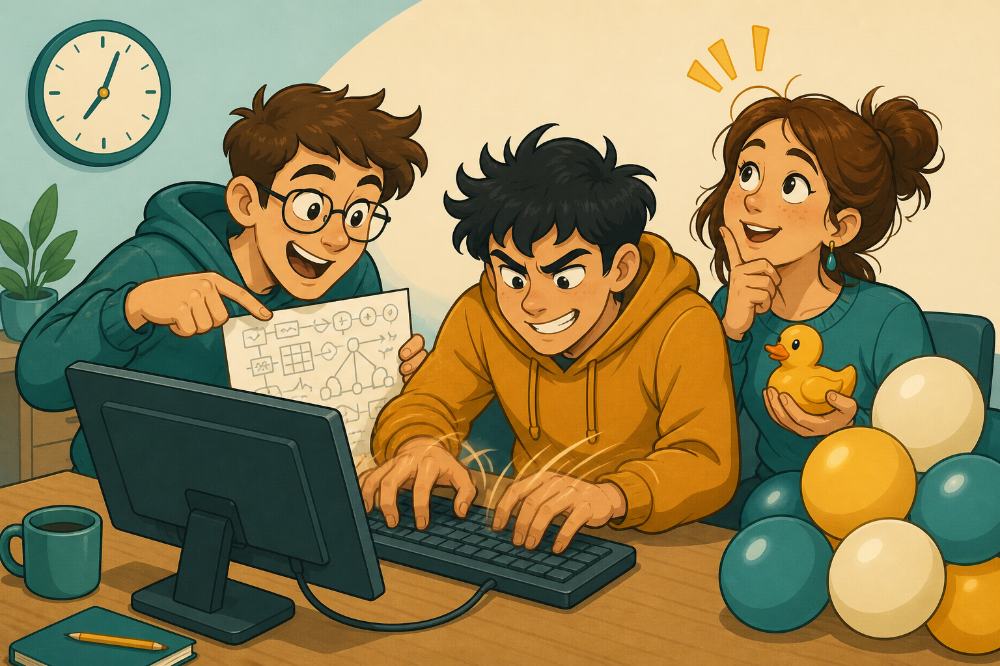
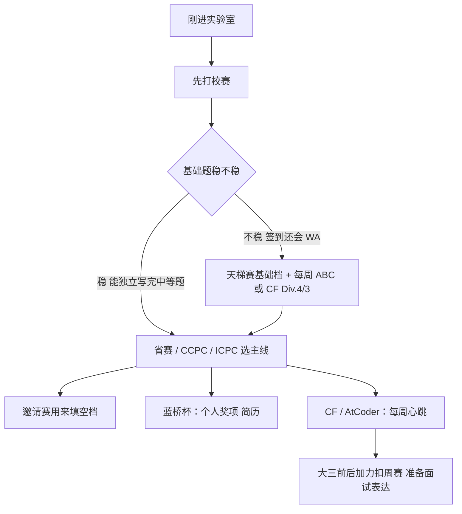
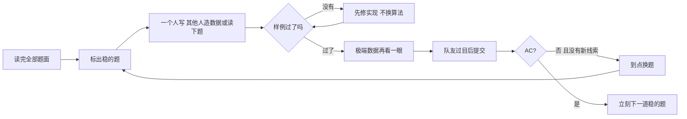
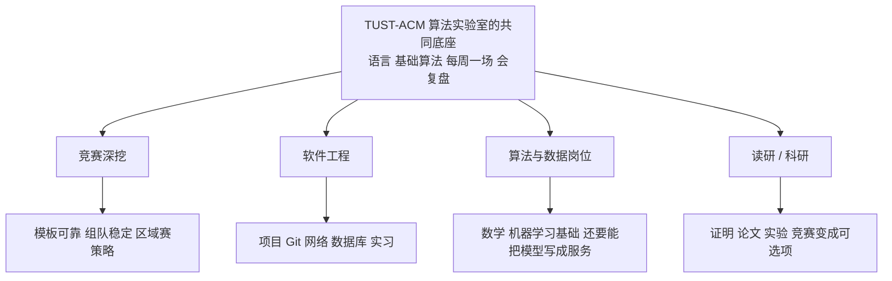
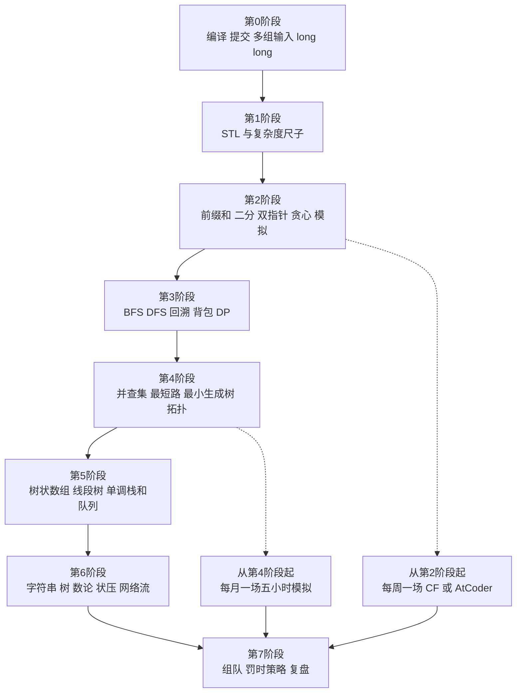

# 从签到题到气球：TUST-ACM 算法实验室的竞赛与学习地图

> 读完这篇，你应该能向一个完全没接触过竞赛的同学讲清楚：算法竞赛在比什么、一场比赛的规则怎么计分、国内那些名字相近的比赛各自有什么用、以及一个人从「会写循环」走到「能打完一场五小时」大概要经过哪些阶段。它不是获奖承诺，是一张能照着走的地图。

机房里通常有三种声音。第一种是键盘，急，但不乱。第二种是有人把椅子往后一推，说「样例过了」。第三种最常见：屏幕上跳出一行红色的结果，全场安静半秒，然后有人开始笑。那一行红色不代表你不适合学计算机。它只说明评测机比你的自尊心诚实。

TUST-ACM 算法实验室就长在这种声音里。全称是 **TUST-ACM 算法实验室**，TUST 是天津科技大学（Tianjin University of Science and Technology）。对外、对内都用这个全称；简称 TUST-ACM 可以，但不要写成「ACM 社团」或「ACM 团队」当作官方名字。也不是 AMC——中间那个字母是 C。C 可以记成 Contest，也可以记成 Code。两个都对，拼写错了就不对。


实验室要做的事说起来很窄：把算法竞赛这件事，从「网上看起来很酷」变成「这学期我知道自己该练什么」。窄，但是够一个人用整个本科。下面按这个顺序写：竞赛是什么，规则怎么算，各种比赛各管哪一段，它到底有什么用，然后是学习路线。路线会细到「这个数据范围大概该用什么」，因为含糊的路线图只适合贴在墙上，不适合拿来开电脑。

## 算法竞赛在比什么

把宣传册上的形容词先放下。一场 ACM 类算法竞赛，本质上是这样一件事：

主办方给出若干道题。每道题有输入、输出和限制（时间、内存、数据范围）。你写一个程序。程序被送到一台你碰不到的评测机上，用你看不到的很多组数据跑。全部通过，这道题才算做出来。少一组，整题不算。没有「思路对了给一半分」这回事。

所以它同时在考四样东西，而且四样都会单独把你送回家：

1. **读题。** 把一段中文或英文翻译成「输入是什么、要输出什么、什么情况下算对」。
2. **建模。** 认出这是最短路、二分、背包，还是一道披着故事外衣的模拟。
3. **实现。** 在有限时间里把想法变成能编译、能处理边界的代码。
4. **策略。** 五小时里先做哪题、卡了多久该换、队友的电脑时间怎么分。

第四样经常被忽略。会做题的人很多，会在五小时里把会做的题稳稳交上去的人少一截。竞赛的残酷之处就在这里：评测机不批改你的草稿，也不给你的努力打分。

可以用一个不那么浪漫的比喻。竞赛像食堂高峰期。队伍很长（数据很大），打饭的窗口只有一个（时间限制）。你不能因为「我知道这道菜怎么做」就插队；你得真的把饭打出来，而且不能把汤洒到别人的餐盘上（输出格式错一位，照样算错）。

### 和另外两种「做题」不要混

同学嘴里的「刷题」至少有三种，规则完全不同。混在一起，会以为自己在训练，其实在做别的运动。

| | ACM / ICPC 类 | 信息学奥赛（OI）类 | 面试题 / 力扣周赛类 |
| --- | --- | --- | --- |
| 谁来做 | 通常三人一队、一台电脑 | 个人 | 个人 |
| 计分 | 做对题数，再用罚时打破平局 | 测试点给部分分 | 做对题数，或按通过用例给分 |
| 反馈 | 整题通过或整题失败，看不到哪组数据错了 | 常常能看到部分测试点 | 多数时候能看到部分用例 |
| 时长 | 区域赛常见 5 小时 | 更长，按当年赛制 | 周赛常见 1.5～2 小时 |
| 代码风格 | 短、快、能当场写完 | 同样要求正确，但部分分鼓励更稳的写法 | 更接近「讲得清思路」 |
| 主要练什么 | 建模、实现、协作、赛时取舍 | 算法深度、部分分策略 | 手写常见题、表达 |

TUST-ACM 算法实验室的主线是第一列。另外两列不是敌人。高中打过 OI 的同学，算法底子往往更好，但要重新适应「没有部分分、还得和两个人共享一把键盘」。准备实习的同学可以去写面试题，只是别用周末四道力扣代替一场五小时。肌肉不一样。

信息学竞赛里常见的「文件输入输出、按测试点给分、允许写一个更慢但能拿部分分的算法」，在 ICPC 类比赛里基本不存在。这里是 **Accepted 或不是**。这种全有或全无，会逼你把边界想完再交，也会让人在差一个等号的时候怀疑人生。两种感受都是真的。

## 一场比赛，从进场到出厂

规则表可以后看。先把一场典型的现场赛走一遍，后面的名词才有地方放。

赛前一小时，队伍到达。三个人，一台电脑，一叠试卷，若干支笔。志愿者会检查随身物品。手机通常要收起来。教练可以送到门口，进场之后不能再传纸条。这个细节每年的执行松紧不一样，原则不变：**比赛开始后，队外的人不能帮你想题。**

开赛。三个人同时翻题。有人从第一题往后读，有人先扫每题的数据范围和样例，有人专门找「看起来像模拟」的题。十分钟之内，应该有人开始敲第一道签到题。签到题的意思不是「侮辱智商」，而是「把编译、输入输出、提交按钮这些非智力环节先跑通」。很多队的第一滴血不是输在算法，是输在把 `long long` 写成了 `int`，或者忘了多组数据。

接下来的两小时是最舒服的。简单题被拿下，气球开始送到座位上——对，现场赛做对一题，志愿者会送一个对应颜色的气球。气球没有算法含量，但是它很重。不是物理上重，是你回头能看见自己这五小时没有白坐。

中间两小时开始难看。剩下的题都「好像会」。好像会，是竞赛里最昂贵的错觉。一个人占据键盘四十分钟，样例始终差一组；另外两个人在纸上推了三版公式，谁也不敢说自己对。好的队伍会在这里做一个很失礼、但很正确的决定：把键盘要回来，换题。

最后一小时，榜单冻结。你交上去的代码仍会被评测，你自己看得到结果，公众榜上看不到。隔壁队突然安静，你不知道他们是放弃了还是做出来了。这一个小时考的不是新算法，是信息不全时还敢不敢按自己的判断交题。

出厂之后才是真正的训练。当场没做出来的题，回去补。补的时候写下「我卡在读题、思路还是实现」。不写这句话，下次还会卡在同一个地方，而且会以为是新问题。



三个人一台电脑，像三个人合吃一碗面，筷子只有一双。会抢筷子的队，实力会被键盘浪费掉。所以组队不是「把三个都会写代码的人捆在一起」，而是提前说好：谁主敲、谁读下一题、谁构造一组能把程序打崩的数据。橡皮鸭不是吉祥物。把思路讲给鸭子听，讲到一半自己发现漏洞，这在实验室里是正经调试方法，鸭子甚至不必到场。

## 规则：细致到能自己算一遍罚时

下面这些是 ICPC 类比赛多年不变的骨架。页数限制、能不能带纸质模板、编译错误算不算罚时，个别赛会改。**进场前以当届竞赛手册为准。** 手册和这篇冲突时，听手册的。跟志愿者辩论「我在一篇博客里看到可以带 25 页」不会增加通过题数。

### 谁可以上场

- 一支队伍最多 **3 名在校本科生**（研究生能否参赛、跨校组队是否允许，看该项赛事的报名通知，不要自行脑补）。
- 队员一般须来自同一所学校。
- 一台电脑。不是每人一台再取最高分，是真的只有一把键盘。
- 教练可以带队，不能在比赛中提供解法。

这套规则故意制造稀缺。稀缺的是键盘，也是注意力。一个人想到了正确算法但讲不清，等于没想到。TUST-ACM 算法实验室平时训练就要磨这件事：你的解法如果不能在两分钟内让队友听懂，它在赛场上就还不算一个解法。

### 赛长和题量

区域赛、邀请赛最常见的是 **5 小时**。题目数量常见是 **10 到 13 道**，按 A、B、C…… 编号，难度不严格按字母排序。A 题通常更简单，但「通常」不是承诺。每年都有队伍死磕一道放在前面的难看题，把后面两道送分题留给别的学校。

线上赛有时更短或更长，题量也会变。网络赛的意义经常是选拔：过了线，才有现场赛的椅子。现场赛才是这套运动的本体——同一间屋子、同一套题、气球会走路。

### 你能用什么语言

常见可选语言是 C、C++、Java、Python，有的赛会加 Kotlin。工程上的建议非常偏心：**用 C++。**

不是因为别的语言低人一等。是因为这套比赛的时间限制，很多是按 C++ 的常数来卡的。Python 写签到题很温柔，写一张图论题可能还没开始思考就先收到超时。Java 能打，但输入输出和常数要额外小心。实验室默认把 C++ 当成赛场语言，把 Python 留给我写脚本、对拍和以后做工程的时候。

编译命令在自己电脑上就该练熟，不要只按绿色三角：

```bash
g++ -std=c++17 -O2 -Wall a.cpp -o a
```

`-O2` 不是装饰。有的题本地不优化能过、评测机开优化才过，反过来也有。`-Wall` 会在你交题之前先骂你一句，这句骂比 Wrong Answer 便宜。

### 评测结果是一本小词典

交上去之后，你会看到一串缩写。第一次见像在读医检报告。其实就这几句人话：

| 结果 | 人话 | 赛场上先查什么 |
| --- | --- | --- |
| Accepted（AC） | 所有数据都对 | 收气球，换下一题。不要当场重构 |
| Wrong Answer（WA） | 程序正常结束，但输出不对 | 样例、边界、取模负数、多组数据没清空 |
| Time Limit Exceeded（TLE） | 太慢，或死循环 | 复杂度是否配得上数据范围；循环退出条件 |
| Memory Limit Exceeded（MLE） | 开太大了 | 数组维度、递归深度、有没有把图存成巨大的邻接矩阵 |
| Runtime Error（RE） | 中途崩了 | 数组越界、除零、递归爆栈、空指针 |
| Compilation Error（CE） | 没编译过 | 头文件、分号、提交错文件。ICPC 体系里 CE 通常不计罚时，别的赛不一定 |
| Presentation Error（PE） | 输出格式差一口气 | 现在很多赛已经把 PE 并进 WA，别对它抱有幻想 |
| Pending / Judging | 还在排队 | 深呼吸。反复刷新不会让队列变短 |

Wrong Answer 是室友，不是判决书。它只说「有一组数据你错了」，不说哪一组。这就是 ACM 类比赛和很多作业平台的差别：没有人把反例打印给你。你要自己变成那个制造反例的人。

一组很管用的自查顺序，建议写在模板注释里，直到你不看也能做：

1. 官方样例是否真的过了，包括样例之间的空行。
2. 最小数据：`n = 1`、空图、只有一个点。
3. 最大数据：开的数组够不够，时间够不够。
4. 负数、零、重复元素、自环。
5. 多组输入时，全局数组、`map`、`vector` 有没有清空。
6. 下标从 0 还是从 1。
7. 和大于 `2^31 - 1` 时有没有用 `long long`。
8. 取模之后出现负数：`(x % mod + mod) % mod`。

这八条解决不了所有 WA，但能解决那种「我算法没错，我只是不配 AC」的 WA。后者其实更常见。

### 排名：先比题数，再比罚时

排名规则是这套比赛的性格。

**第一关键字：通过的题数。** 做对 5 题的队，永远排在做对 4 题的队前面。罚时再漂亮也不能翻过这个坎。所以赛场上「再花 40 分钟把这题证完」常常是错的，如果旁边还有一道 15 分钟能写完的题。

**第二关键字：罚时，越少越好。** 只统计已经通过的题。没做出来的题，交错一百次也不计入罚时——当然，你的时间和心情已经计入了。

一道已通过的题，罚时是：

> 从开赛到第一次 AC 的分钟数 + 20 × 这次 AC 之前的错误提交次数

编译错误在 ICPC 的通行规则里 **不加** 这 20 分钟。国内个别比赛会改这条，再强调一次：看手册。

把三道题算完，你就再也不会把罚时当成玄学。

假设 9:00 开赛。

- A 题 9:17 一次 AC。罚时 = 17 分钟。
- B 题 9:20 错一次，9:35 又错一次，9:48 AC。罚时 = 48 + 20 × 2 = 88 分钟。
- C 题错了三次，到结束也没过。罚时 += 0。
- 通过 2 题，总罚时 = 17 + 88 = 105。

另一支队也过了 2 题，总罚时 90。他们排在前面。你的算法不一定比他们差，你的提交更贵。

由此得到几条很具体的习惯：

- 没过样例不要交。一次错误就是 20 分钟，外加你自己的心烦。
- 开赛前 30 分钟的签到题，罚时天然便宜；拖到第 4 小时才做，同样的题会贵 200 分钟。读题顺序是策略，不是个性。
- 一道题已经错了两次，第三次提交前必须有新信息：一组新数据、一个被找到的 bug、队友独立推过的公式。不要用「再交一次试试」当调试器。
- 金牌和银牌的差距，有时不是一道不会的题，是两道会的题各多交了一次。

### 封榜

多数现场赛在结束前 **60 分钟** 封榜。封榜之后：

- 你仍然可以提交，评测结果你自己能看到。
- 公众榜不再更新别人的新通过。
- 比赛结束、讲题之前，会有滚榜：把冻结的一小时按提交顺序播出来。

滚榜是这套比赛少数可以拿去招待外行的部分。一支队在封榜时排第 40，滚完变成第 12，屋子里会叫。另一支队眼睁睁看着自己被挤下去，屋子里也会叫，只是声调不同。


封榜不是用来制造悬念给观众的，虽然它顺便做到了。它是为了防止后半段变成「看榜抄作业」：看见某题通过数突然变多，全场一窝蜂去写那题。冻结之后，你只能相信自己的判断。这个设计很适合训练一种以后写程序也会用到的能力——信息不完整时，仍然把下一步做完。

现场赛还有一个传统：某题全场第一个通过，叫 first blood，有的赛会用特别的气球或标记。它很光荣，也很危险。为了抢一个标记去交不稳的代码，罚时会计账。气球记得你，罚时也记得你。

### 澄清、资料、以及什么叫作弊

比赛中可以提交澄清（clarification）：你认为题面有歧义，向主办方提问。好的澄清是「输出如果有多种答案，是否都算对」。坏的澄清是「这题是不是网络流」。主办方对后者的标准回答是 No comment。澄清不是远程助教。

纸质资料（模板、书）是否允许、允许多少页，每年都在变。电子设备和网络，默认不行。赛场上打开手机查一篇博客，不是「合理使用搜索引擎」，是作弊。TUST-ACM 算法实验室把这件事说得很白：训练时可以搜，赛时按规则来。平时把搜索当拐杖，上场会被收走拐杖。

代码可以在队内共享——本来就只有一台电脑。不可以接收队外的代码、思路或测试数据。包括赛后还没结束的网络赛：题解发到群里，对还在打的人就是伤害。

## 那些名字很容易看花的比赛

「算法比赛」不是一场比赛的名字。它是一抽屉印章，每个印章盖在不同的地方。下面按一个天津科技大学的同学真的可能遇见的顺序来写。年份和站点会变，作用比较稳。

### 校赛：第一次被五小时严肃对待

校内赛是门槛最低、反馈最快的一场。题不一定难，难的是你第一次体验「三个人一台电脑，而且真的会计时」。TUST-ACM 算法实验室看重校赛，不是因为名次会写进国家档案，而是因为：

- 它是组队的试镜。纸上觉得合得来的人，卡题四十分钟之后才知道合不合得来。
- 它是提交系统的彩排。账号、编译器版本、输入输出习惯，都在这里暴露。
- 它让下一届看见：实验室不是一个群聊，是一间会办比赛的屋子。

打完校赛就消失的人，和打完校赛回来复盘的人，一个学期后会变成两种选手。差别通常不是天赋。

### 省赛：从「我们学校」走到「这个省」

省级大学生程序设计竞赛，规则多半仍是三人一机、限时、按题数和罚时排名。对手换成全省的学校。它的作用很具体：给你一个比校赛更不讲情面的参照系。校赛第 1 可能只说明本校今年新生强；省赛中游会告诉你，区域赛的签到题你还稳不稳。

省赛也是很多同学第一次坐大巴、第一次在陌生机房用别人的键盘。这些琐事影响成绩。提前摸键盘、确认编译器版本、知道厕所在哪，都算准备。

### CCPC：中国大学生程序设计竞赛

CCPC（China Collegiate Programming Contest）是国内高校自己的一套区域赛体系。赛制和 ICPC 高度同构：队伍、一台电脑、限时、罚时、现场气球。站点每年换，可能在不同城市设赛区，通常先有网络赛选拔，再办现场赛。

它的作用：

- 对学校：这是国内最被同行看见的成绩之一。
- 对个人：一张区域赛的铜牌或银牌，比一段「熟悉常见算法」的自我评价更难伪造。
- 对训练：网络赛检验的是「会不会」，现场赛还检验「换一台电脑还会不会」。

CCPC 不是 ICPC 的预选赛，也不是谁比谁低一级。它们是两套日程、同一类运动。一年里两套都打的队伍很常见。精力不够时，先打稳一套，比两套都去「体验一下」有用。

### ICPC：名字里那个老词

很多人说的「ACM 竞赛」，正式名字是 ICPC（International Collegiate Programming Contest）。ACM 曾经是它的主要赞助方，习惯叫法留了下来，所以实验室的名字里有 ACM，比赛的大门上写的是 ICPC。两个都对，别在报名表上发明第三个缩写。

路径大致是：

1. 网络选拔赛，决定哪些队能去区域赛现场。
2. 区域赛现场，决出金银铜和晋级名额。
3. 更高一层的大陆赛、洲际赛（名字这些年改过，以当年通知为准）。
4. 世界总决赛（World Finals）。那是这个项目的天花板，不是大一的周目标。

ICPC 的作用和 CCPC 同族，多出来的是：英文题面更多、国际规则更统一、世界总决赛这条路是真的存在。英语在这里不是素质教育，是读题速度。不要求你能做同声传译，要求你能在十分钟内读懂一道题的输入输出和数据范围。读不懂就去翻词典，不要去翻队友的表情。

### 邀请赛：加赛，不是加戏

各高校会办邀请赛。规则通常仍是 ICPC 那一套，强度从「新生友好」到「区域赛原题难度」都有。它的作用是加节奏。只有校赛和区域赛的年份，中间会空出几个月，手会生。邀请赛把空档填上，也让队伍在不那么要命的场次里试验新的分工。

请分清「参赛」和「旅游」。报了名、做了题、写了复盘，才叫参赛。

### 蓝桥杯：个人的，部分分的，简历认识它

蓝桥杯软件类是个人赛，常见路径是省赛再国赛。组别按语言分，C/C++ 与 Java 是长期主力，是否单设 Python 组看当年简章。题型常常包括填空和编程，编程题可以按测试点拿部分分。

它 **不是** ICPC 的替身。一个人可以两样都打，但训练方法不要混：

- 蓝桥的填空题会奖赏细心和手算，五小时团队赛不考这个。
- 部分分会让你愿意写一个 `O(n^2)` 先拿 60%。区域赛里这个程序的名字叫 TLE。
- 它的奖状是个人的。没有队伍的时候，它仍能给你一个可核验的结果。

简历上写蓝桥奖项完全正当。只是面试官如果问「你们队区域赛怎么分工」，蓝桥回答不了。

### 团体程序设计天梯赛：学校的积分，个人的键盘

天梯赛（Group Programming Ladder Tournament）和 ICPC 看起来像亲戚，其实是另一项运动。

- 一支学校队伍人数更多，常见上限是 10 人，以当年简章为准。
- **每个人自己的电脑**，各自做题，不是三人抢一把键盘。
- 时长常见 3 小时。
- 题目分成几个梯级：基础、进阶、顶级。基础题就是基础题，不要因为你在准备区域赛就跳过，跳过之后学校积分会教育你。
- 学校成绩与队员个人得分的汇总方式有关。个人也有排名。

它的作用偏学校荣誉和普及。对 TUST-ACM 算法实验室，天梯赛是把「会写程序的人」尽量多地拉到同一张卷子上。区域赛名额只有几支队，天梯赛能让更多队员在正式计时里交一次卷。基础不稳的人，天梯赛的前半张卷子比一场 Codeforces 更适合当体检。

### Codeforces：每周一次的诚实

Codeforces（常被叫 CF）是线上个人赛。一轮大约两小时，题目从易到难。它有等级分（rating）。你做对题，分数涨；发挥失常，分数掉。比赛分成 Div.1、Div.2、Div.3、Div.4，数字越小通常越难。

它的作用，是区域赛之间的心跳：

- 固定场次，外部约束。没有 DDL 的刷题很容易变成「这周先看看剧」。
- 两小时的压力比五小时便宜，适合练读题和手速。
- 赛后有题解。要先自己补，再看题解。顺序反了，题解会变成电视剧。

rating 是反馈，不是人设。掉分的那周，你仍然是会写并查集的那个人。涨分的那周，也不要立刻去改签名。TUST-ACM 算法实验室在意的是你有没有复盘，不是你的颜色。

CF 还有一个机制值得知道：部分比赛先跑预测试（pretest），赛时显示通过，赛后系统测试仍可能把你打下。所以「赛时过了」不等于「这题你真的写对了」。这和区域赛不一样，区域赛的 AC 就是 AC。两种反馈都要认识，免得把 CF 的虚分当成现场赛的实力。

### AtCoder：题面干净，适合练实现

AtCoder 的 Beginner Contest（ABC）每周都有，题面短，从真正的入门铺到需要想法的题。ARC、AGC 更难。它的作用是把「我会这个算法」变成「我能在四十分钟内不写错」。很多人算法课成绩很好，ABC 的 C 题写二十分钟，因为手生。手生是可以治愈的，药方很无聊：每周一场，赛后把没做的题补完。

### 力扣周赛：别用它代替主线，也别瞧不起它

力扣周赛四道题，大约一个半小时，风格更接近面试。它练的是「常见模型的手写速度」和「把思路说清的能力」。找实习之前，它有用。把它当成 ICPC 训练的全部，然后去打区域赛，会在第五道题开始遇到从未见过的东西：图、字符串和数据结构叠在一起，而且没有中文题解弹出来。

反过来，只打 ICPC、从没把自己的解法讲给一个不打竞赛的面试官听，也会吃亏。两种题都做一点，主次要清楚。实验室的主线仍然是 ICPC 类。

### 一张「我该报哪场」的图



这场图不是审批流程。它是为了防止两种浪费：基础没稳就只盯着世界总决赛的游记；已经能打区域赛了，还每周只做签到题然后惊讶自己没长进。

## 它有什么用，以及它没有什么用

先写没有的，免得后面的好处看起来像招生广告。

算法竞赛 **不保证** 保研、不保证大厂 offer、不保证你成为「算法工程师」。奖状是奖状，岗位是另一套考试：项目、基础课、实习、表达、时机。把区域赛铜牌理解成「我在高压下能把一个抽象问题做成可运行的程序」，这个翻译是诚实的。把它理解成「所以我应该被录取」，这个翻译是你自己加的。

然后再写它真的给得了的东西。这些东西比较慢，比较难贴在朋友圈里。

### 把「好像会」杀掉

课内考试有时可以靠「我见过类似的题」蒙过去。评测机不行。你必须把程序跑到结束，而且对未知数据也对。这种反馈会培养一种后来写任何程序都有用的洁癖：边界是代码的一部分，不是写完再看的附录。

TUST-ACM 算法实验室希望队员带走的，与其说是某一份模板，不如说是这句口头禅——**先说复杂度，再说你要交。** 说不出口，通常就是还不会。

### 协作被强制发生

三人一机让「我自己偷偷会了」变得不够用。你得分工、得交接键盘、得在队友写错的时候指出错误而不是翻白眼。以后做工程，代码评审里的很多话，赛场上已经说过一遍：「这里越界了」「这组数据没清空」「你这个函数在做三件事」。

实验室是这件事的固定场所。一个人在宿舍也可以刷题，但没有人把键盘从你手里拿走，你就很难发现自己已经卡了四十分钟。

### 抗压是可以练的，而且应该在学校练

封榜、罚时、滚榜，都是设计过的压力，而且压力结束于当晚。比起第一次在面试里脑子空白，这是更便宜的练习场。有人赛后会很难受。难受可以有，第二天要把「我卡在哪」写下来。只保留情绪、不保留结论，压力就白受了。

### 简历上怎么写才不像在背课文

可以写的：哪一年、哪一场、什么奖项、你在队里的分工、你真正写过的算法。  
不要写的：「精通全部算法」「负责核心算法架构」（三个人写了 13 道题，没有架构）。  
如果没有奖项，写训练也行，但要具体：每周比赛、独立完成过哪些类型、有没有带过新人。空泛的「热爱算法」面试官见得比气球多。

### 对学校、对下一届

一支稳定的队伍会改变一所学校的默认值。新生进来，看见的不是「计算机就是写网页或者修电脑」，而是「这里有人把难题当成手艺」。TUST-ACM 算法实验室的价值，有一块不在当年的奖状上，在下一届少走的弯路上。你搞懂一个坑，写下来，它才算实验室的。留在聊天记录里，毕业就没了。

## 学习路线：为什么不能从线段树开始

路线图最容易写成一串名词：贪心、搜索、动态规划、图论、数据结构、字符串、数论、网络流。名词都对，顺序一错就变成受刑。

线段树是好东西。它不适合当第一周的礼物。第一周的礼物是：程序能编译，提交能 AC，你知道 `n = 10^5` 时双重循环大概会死。基础不稳的人去背线段树模板，会得到一份自己改不动的代码，以及一种「我学过高级算法」的幻觉。幻觉比不会更妨碍学习。

下面的阶段按「过关标准」来写，不按「看过视频」来写。看过不算。能独立写出来，并且能说出复杂度，才算。


时间是经验值，不是合同。有高中基础的人会快，每周只有三小时的人会慢。慢不是失败，断更才是。

### 第 0 阶段：先活过提交按钮

大约 2～4 周。目标很小，小到不好意思写进计划，但不完成的话后面全是空中楼阁。

要会的：

- 用 g++ 在终端编译，而不是只会点运行。
- 读入整数、读入字符串、处理多组数据直到文件结束。
- 知道 `int` 大约到 2×10^9，和可能爆掉时换 `long long`。
- 数组别开在栈上开出几千万。
- 在某个在线评测网站上独立 AC 最简单的输入输出题。

过关标准：给一道「读入 n 个数，输出和」的题，你能在 15 分钟内写完并 AC，包括 n 的和超过 `int` 的那种。听起来侮辱人。每年都有人在这里交出人生第一发 WA，然后发现程序是对的，输出多了一个空格。

这个阶段不要谈人生方向。先让电脑听你的话。

### 第 1 阶段：语言变成肌肉

大约一个学期里的前半，可与第 0 阶段重叠。竞赛不考你背诵语法书，但卡手的语法会吃掉你的罚时。

优先熟练这些，而不是「把 C++ 全书读完」：

- `vector`：变长数组。排序、去重、当邻接表。
- `sort`：以及比较器。很多贪心只是「先排个序」。
- `string`：整行读入、数字和字符串混在一起时别用错 `cin`。
- `map` / `set`：这个数出现过没有，这个键对应的值是多少。
- `priority_queue`：随时拿当前最值。
- `stack` / `queue`：括号匹配、广搜。
- `pair`：两个数绑在一起排序。

同时建立复杂度直觉。不要背表，用厨房时钟想：

| 数据范围 n | 你大概负担得起 | 负担不起 |
| --- | --- | --- |
| ≤ 10 | 全排列、暴搜 | 没什么负担不起，但要写对 |
| ≤ 20 | 2^n 的状态压缩 | n^3 的图算法可能已经偏大 |
| ≤ 500 | n^3 | 别写 n^4 |
| ≤ 5000 | n^2 | 别写 n^3 |
| ≤ 10^5 | n log n | 朴素 n^2 |
| ≤ 10^6 | n 或小心的 n log n | 常数大的 n log n、`map` 乱套 |
| ≤ 10^18 | 数学、二分、对数次 | 任何企图遍历到 n 的循环 |

这张表是尺子，不是法律。常数、内存、是否要取模，都会把尺子拧弯一点。但你如果看见 `n ≤ 10^5` 还写下双重循环，尺子会先响。

过关标准：能不看文档写出「读入、排序、二分查找、用 `map` 计数」。写的时候允许慢，不允许每五行查一次「vector 怎么定义」。

### 第 2 阶段：六个会反复见面的基础模型

这是投入产出比最高的一段。区域赛的签到和铜牌题，大量是这些模型的变体。

**前缀和与差分。** 多次询问一段区间的和，就先做成前缀和，询问变成两次减法。差分是它的反面：对区间做修改，最后一次求前缀得到每个点的值。会写一维之后再看二维。

**二分。** 不只是在有序数组里找一个数。更常见的是「二分答案」：答案具有单调性，猜一个值，检查可不可行。检查函数写对，比背 `lower_bound` 重要。`lower_bound` 也要会，它是手写二分的防呆版。

**双指针 / 滑动窗口。** 数组上一段连续区间，右端点往前走、左端点也不回头。它经常把 n^2 变成 n。前提是你真的能证明左端点不必后退。不能证明就不要叫双指针，那只是两个变量。

**贪心。** 局部选择导致全局最优。它最容易被用错。每写一个贪心，强迫自己补一句「为什么不存在反例」。补不出这句，就把它降级为猜想，换个方法，或者打一张表对拍。

**构造与模拟。** 不高级，但很赚罚时。按题意把过程写对，处理好结束条件。模拟题死于看错一行题面的人，比死于不会网络流的人多。

**枚举。** 暴力不是羞辱。暴力是基线。你要知道最笨的方法有多慢，才知道优化在优化什么。n 很小的时候，暴力就是正解，写一个复杂算法反而是罚时。

过关标准：给一个新题，你能在读完数据范围后说「这题我先尝试二分 / 前缀和 / 直接模拟」，并且独立 AC。不要求快，要求不是打开题解才知道自己在写什么。

### 第 3 阶段：搜索，和第一次正经的动态规划

**广度优先搜索（BFS）。** 边权都是 1 时，第一次到达就是最短路。网格里上下左右走，是它最常见的样子。队列里放什么，访问标记什么时候打，这两件事写错，程序会在同一个格子里散步到超时。

**深度优先搜索（DFS）与回溯。** 选或不选、全排列、走迷宫并记得回来。回来是关键。递归下去改了的状态，返回时要撤销。忘了撤销，你就是在一张越来越脏的桌子上做实验。

**洪水填充、连通块。** 图或网格上「有多少块连在一起」。它是 BFS/DFS 的直接应用，也是并查集出现之前的替代方案。两种都要会，才知道什么时候不该用哪一种。

**动态规划，从背包开始。** 01 背包是动态规划的方言课：状态是什么，转移为什么不漏，滚动数组为什么能省内存又为什么容易写反循环方向。搞懂这一题，再去见最长上升子序列、区间 DP、树形 DP。

动态规划的学习顺序，建议锁死，不要跳：

1. 能讲出状态的含义（不是背数组名字）。
2. 能讲出转移在枚举什么决策。
3. 能讲出初始化和答案放在哪一格。
4. 最后才是空间优化。空间优化写错，查错成本极高，不适合第一天。

记忆化搜索和递推是同一种思想的两种写法。先写你不容易写错的那种。两种都要见过，因为有的状态用递推不自然，有的用递归会爆栈。

过关标准：网格最短路能独立写完；01 背包能从二维写到一维，并且说清循环方向；一道「方案数」题，你知道取模要放在每一步而不是最后。

### 第 4 阶段：图，要认得该用哪把刀

图论名词很多，铜牌水平其实依赖很少的几把刀，但每一把都要快。

- **存图。** 邻接表是默认。只有点很少时才用邻接矩阵。把 10^5 个点的图开成矩阵，是 MLE 的经典散文。
- **并查集。** 谁和谁是一伙的。合并、查询、路径压缩。它还负责最小生成树里的「这条边会不会成环」。
- **最小生成树。** Kruskal：边按权排序，不成环就收下。Prim 知道即可。
- **最短路。** 边权非负用 Dijkstra，配合堆。边权有负、没有负环，才轮到 Bellman-Ford 或 SPFA。SPFA 不是万能钥匙，它在网格上被卡成平方是常事。Floyd 只属于点很少的图。
- **拓扑排序。** 依赖关系，先修课。能排出来说明没有环。排不出来，题可能就在问环。
- **二分图染色。** 能不能把点分成两类，同一类之间没有边。它常常装成「能不能分组」。

过关标准：看见「连通」「环」「依赖」「最短」「最小生成」，你能在一分钟内说出数据结构的名字，并且半小时内写完裸题。裸题写得慢，套题一定更慢。

### 第 5 阶段：会动的前缀和，也就是数据结构

前缀和解决的是「问很多次、数组不再改」。数组要改，前缀和就过期了。这时才请出：

- **树状数组。** 单点加、前缀和查询，或者反过来。代码短，适合先建立「树状下标」的直觉。
- **线段树。** 区间加、区间求和、区间最值。懒标记是「先欠着，有人问到再还」。第一棵线段树请只写区间求和，不要第一天就上扫描线。
- **单调栈。** 右边第一个比它大的位置。每个元素进栈出栈各一次。
- **单调队列。** 滑动窗口最值。窗口在动，队列保持单调。

这四样是区域赛里最常被「套壳」的工具。壳可能是直方图、天气、股票、排队。剥开壳，还是「区间最值」或「下一个更大」。

过关标准：线段树模板能默写到一次 AC 裸题。默写不是炫技。赛场上没有你的收藏夹。

### 第 6 阶段：专题。到这里才配叫「在打竞赛」

前面是通识，这里开始分叉。不要求一个学期全部吃完。要求每吃一个，就有裸题和一道变体，而不是笔记里的一个标题。

**字符串。** [哈希](字符串哈希.md)（把一段字符收成一个整数，注意冲突）、[KMP](KMP.md)（模式串自己和自己比较，失配时不要从头再来）、[字典树](字典树.md)。[AC 自动机](AC自动机入门.md)是多模式串，可以晚一点。

**树。** [最近公共祖先](LCA倍增.md)、[树上差分](树上差分.md)、子树与路径的区分。[树链剖分](树链剖分入门.md)是「把路径切成几段区间」，区间再交给线段树。它很著名，也很容易在基础不稳时变成天书。天书先放书架上。路径条数看 [点分治](点分治.md)，无向图拆点拆边看 [割点与桥](割点与桥.md)。

**数论。** [最大公约数、质数筛、快速幂](数论入门.md)、逆元、[欧拉函数](欧拉函数.md)、[中国剩余定理](中国剩余定理.md)。数论题的特点是代码短、坑密。一个取模写错，WA 到怀疑人生。对拍在这里特别值钱。计数上的加减见 [容斥](容斥原理.md)。

**更多动态规划。** [状压](状压DP.md)（把集合塞进一个整数，n ≤ 20 的味道）、[数位](数位DP.md)（按十进制一位一位填）、[区间](区间DP.md)、[树形](树形DP.md)。看到状态超过三维，先怀疑自己是不是设计重了。窗口里的转移见 [单调队列优化](单调队列优化DP.md)，交叉项见 [斜率优化](斜率优化DP.md)。

**二分图匹配与网络流。** 左右两组配对、水管能流多少。它们是模型识别：认得出来，套上板子，改对建图。建图比背算法难。第一道最大流请从「这张图的边是什么」开始学，不要从代码第 1 行开始背。已有成稿：[二分图匹配](二分图匹配.md)、[最大流](最大流入门.md)、[费用流](费用流入门.md)。

仓库里按模型排好的目录是 [专题对照表](专题对照表.md)。

过关标准不是「专题列表被划完」。是一场模拟赛里，你能判断「这题我见过模型」还是「这题我该放弃去写另一题」。会放弃，是这个阶段的毕业技能。

### 第 7 阶段：赛时。算法表上没有这一章

同样的知识量，排名可以差一截。差在流程。

开赛前 15 分钟（读题时间，如果有的话）不做英雄。三个人把题分成三摞：稳、可能、看不懂。先把「稳」写完。

键盘协议建议提前说死，不要等吵架时再发明：

- 同一时刻只有一个人改代码。
- 主敲的人卡住超过约定时间（比如 20 分钟仍没有新进展），必须交还键盘，哪怕他「就差一点」。差一点是黑洞，它的引力比罚时大。
- 另外两个人的工作是下一题的思路，或者给正在写的题造数据，不是围观。
- 提交前另一个人看一眼：变量清空没有、下标、多测。这 30 秒很亏面子，很赚 20 分钟。

调试也有顺序。先用样例。样例不过还去想新算法，是在给错误的程序装修。样例过了再造极端数据。造不出来，就让队友独立读你的代码，不要先给他讲「我的思路是对的」。思路对不对，代码已经投票了。

赛后 24 小时内复盘，越短越诚实。三行就够：

1. 哪几题是该拿下却没拿下的，原因是读题、实现还是死磕。
2. 哪一题的模型是新的，补题计划放在哪一天。
3. 分工上有没有人空转。空转不是态度问题，是安排问题。



## 方向：竞赛不是隧道，是十字路口

走到第 4 阶段前后，人会开始分叉。这是正常的，不是叛逃。TUST-ACM 算法实验室的主业是算法竞赛，但成员的去向不该只有一种。把路说清楚，是为了让人好好选，而不是让人愧疚。



### 方向一：把比赛打深

适合觉得五小时里的取舍本身就很好玩的人。继续往下的不是「再学一个更长的模板」，而是：

- 模板短、自己写的、赛前一周能全部手打一遍。从网上抄来的 400 行，赛场上改不动。
- 固定队友，固定分工，一起打够数量的模拟赛。临时组队去区域赛，像临时组乐队去录音，能响，但别指望和声。
- 补题优先补「这场该拿下的」，而不是补「榜上最难的那道」。最难的那道对你的名次往往没有贡献。
- 英语题面每周接触，不要等网络赛当天才开始认识单词 penalty。

这个方向的价值是手艺本身，加上一个可核验的成绩。它也会反哺别的方向：你写工程代码时更在意复杂度和边界。

### 方向二：去写真正被人使用的软件

竞赛几乎不教：用户是谁、接口怎么设计、数据库怎么建、上线之后崩了怎么办。这些要另开一条线，用项目学，用实习学。

竞赛仍然有用，只是角色变了。它给你调试习惯、复杂度直觉和「先做能工作的版本」的勇气。它不代替一个能跑起来的课程项目。简历上如果只有奖状没有项目，工程岗位会犹豫；只有项目、代码乱七八糟，他们也会犹豫。两个都有一点，比一个堆到极致更像一个能共事的人。

从实验室出去做开发，不是浪费训练。训练里的代码评审习惯，请一并带走。

### 方向三：算法岗、数据岗

名字里带「算法」的岗位，面试题和区域赛只有一部分重叠。他们可能问机器学习、概率、SQL、一个推荐系统怎么评估，而不是请你写一棵线段树。竞赛强的人学这些会快，因为抽象和实现都不怕。但「会快」不等于「已经会」。

如果你确定走这边，区域赛可以继续打，同时把数学期望、基本的模型评估、一门能处理数据的语言捡起来。不要用「我打过 ICPC」结束自我介绍。用它开头，然后讲你用这套能力做过的别的东西。

### 方向四：科研

科研奖赏的是问题是否新、证据是否够、文章是否诚实。竞赛奖赏的是五小时内是否做对。有人两边都强，有人一边强。高中或本科的竞赛成绩不是研究生入学的充分条件，也不是必要条件。

如果你喜欢「为什么对」超过「怎样在 20 分钟内写完」，可以把证明和论文读起来，把比赛降成兴趣或教学。实验室仍然需要这样的人：你能把一个算法讲到下一届听得懂，这就是科研味道的教学。

### 怎么选，而不怎么焦虑

用一个学期做实验，不要用一个晚上做判决。

- 打了两场完整的五小时，赛后仍然想看题解：竞赛这条至少可以认真走一年。
- 打完只觉得解脱，打开一个网页项目却能坐三小时：工程线请给它正牌时间，不要用竞赛填满日历来惩罚自己。
- 两者都喜欢：大二之前可以并行，大三就要有主线。并行不是各花 10% 的注意力。主线至少占你课外技术时间的七成。

TUST-ACM 算法实验室不要求每个人拿牌。它要求进了门的人 **要么在变强，要么在帮别人变强**。纯围观会把屋子变成自习室，自习室不需要这个名字。

## 把路线收成一张可以贴在桌上的图

阶段之间可以重叠，不要并行到每个都只开了个头。



如果只能记住一句节奏：**平时用两小时比赛练手，每月用五小时模拟练协作，赛后用文字练诚实。** 三件事都做的人，进步看起来很慢，半年后会突然不像同一个人。只做「收藏题解」的人，收藏夹会很丰富。

### 一周长什么样

这不是实验室的官方课表，课表以教练和队长当年的通知为准。这是一条被很多队伍验证过、你可以改数字但不能改结构的周循环。

| 时间 | 做什么 | 不做什么 |
| --- | --- | --- |
| 两晚，各 1.5～2 小时 | 专题裸题。只写一个模型 | 同时打开十二个标签页 |
| 一个固定晚上 | CF 或 AtCoder，全程不看题解 | 赛中查模板网站 |
| 赛后第二天 | 补一场里「差一点」的题，写三行复盘 | 直接复制题解交掉 |
| 周末一块 | 和队友讲题，或给新人讲你刚会的东西 | 用讲题代替自己写代码 |
| 考前一周 | 手打模板，只修你真的会用的 | 新学一个你讲不清的算法 |

给新人讲，是检验你是否真会的最便宜方法。讲清楚了，你的模板会变短。讲不清楚，恭喜，你发现了一个还没学会的部分，而且发现得比区域赛早。

### 一张能力对照，用来自测而不是用来打击自己

| 你现在的状态 | 更像哪个阶段 | 下一场比赛该报的期待 |
| --- | --- | --- |
| 提交按钮还没独立按通过 | 第 0 阶段 | 校赛体验，目标是 AC 至少一题 |
| STL 卡手，双重循环看到 10^5 不害怕 | 第 1～2 阶段 | 天梯赛基础、ABC 前几题、CF 入门场 |
| 搜索和简单 DP 能写，图论裸题要翻笔记 | 第 3～4 阶段 | 省赛或区域赛网络赛，目标是稳前几题 |
| 数据结构能默写，专题认得出一半 | 第 5～6 阶段 | 区域赛现场，目标按队内实力谈铜牌或更高，不空谈 |
| 个人能做，一组队就抢键盘或没人说话 | 第 7 阶段缺了 | 先打邀请赛修分工，再上区域赛 |

奖项目标可以谈，但要跟阶段绑定。第 2 阶段谈世界总决赛，像刚学会煮面条就预约米其林后厨。不是不能去，是顺序反了。

## 常见的坑，细到有点唠叨

**把收藏当成学习。** 题解点开、觉得「懂了」、关掉。第二天写不出来。懂了的定义请改成：合上屏幕能写。

**只刷自己会的题。** 会的题刷起来很舒适，rating 也会配合你维持幻觉。每场比赛至少留下一道「看了题解才会」的题，并在 48 小时内自己重写一遍。看题解和重写之间要隔一夜。隔夜之后还写得出来，才算搬进你的仓库。

**模板过早、过长、过别人。** 第一份模板应该短到你知道每一行在骂什么。从队友那里复制一整套，是借来的勇气，赛场上还的时候会很痛。

**忽略输入输出。** 算法课的伪代码不读多组数据，评测机读。多组之间忘记清空 `vector`，是 WA 界的国民套餐。

**用复杂度感受代替计算。** 「应该不会超时」不是计算。写出这个算法访问每个元素多少次，乘上 n，再跟 10^8 到 10^9 这个很粗的每秒操作量级比一比。比完再交。

**团队里的沉默。** 有人不说话，可能是真的在想，也可能是已经掉队又不好意思。队长要问的不是「你怎么还不说话」，是「你现在卡在题面的哪一句」。后者能回答，前者只能伤害感情。

**赛时开新模型。** 五小时里临时学习线段树，成功案例不是没有，只是少到不能当策略。不会的题用来读、用来放，不要用来现学。

**把 AI 当成队友。** 训练时让它解释报错、对两种写法、生成小数据，可以。让它直接产生一份你读不懂的代码然后提交，你在把训练时间卖出去。正式比赛以当届规则为准，默认按不能用外部模型来准备。上场时空手，不是评测机的问题。

**伤病式刷题。** 连续熬夜，然后恨算法。算法没有收到你的恨。固定场次、睡够，半年的总量会超过「激情两周加放弃一学期」。

## 如果只剩一晚，读哪几段

时间不够的人，按这个顺序取，不要从头愧疚到尾：

1. 罚时那一节，自己把例子再算一遍。算对了，你就理解了这套比赛的性格。
2. 「我该报哪场」那张图，圈出你这个学期真正要打的两场，其他的允许错过。
3. 对照能力表，只认领 **下一个** 阶段。不要同时认领四个。
4. 这一周就打一场两小时的线上赛，赛后写三行复盘。三行比一篇抒情有用。

来实验室的第一件事不是证明自己厉害。是让别人知道你在练，并且你愿意把练会的东西留下来。TUST-ACM 算法实验室的气球会瘪，代码会过时，写下的坑不会。下一届会在某个 WA 的晚上打开它，然后少交那不该交的一次。

那 20 分钟，就算这篇文章的罚时已经赚回来了。
